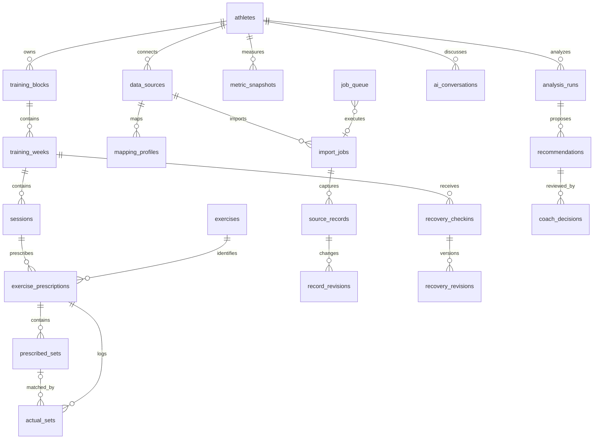

# SQLite ERD and integrity notes

## Key semantics

- IDs are UUID strings generated by the application. Dates/timestamps are ISO 8601 text; store timestamps in UTC and render in the coach's timezone.
- `prescribed_sets` are planned work. `actual_sets` are performed work, each linked to a prescription when known; an extra actual set may have no prescribed set. At most one canonical actual is matched to a prescribed set in this starter schema. A corrected actual is represented by a source revision and an updated canonical row, with audit history.
- `actual_sets.status`: `completed`, `failed`, `skipped`. Absence of an actual row means `unreported`, never zero. A failed attempt can have `reps=0`; a skipped set must have no numeric performance.
- `source_records` capture source location, original display/value JSON, stable natural key, content hash, mapping version and canonical target. Row/column coordinates are evidence, not the sole identity. `record_revisions` preserves prior and new payloads.
- `recovery_checkins` is the current row for a week; `recovery_revisions` records every changed import. A check-in links to an athlete and week, not a set. Week ownership must be validated in application logic or a trigger.
- `metric_snapshots` store calculation version, period, sample count, evidence references and input fingerprint. Changes to source data invalidate affected snapshots.
- `analysis_runs` record rule/prompt/model provenance and evidence snapshot. Recommendations cannot be promoted to a prescription; `coach_decisions` only records a coach action.
- `job_queue` is persisted and recovered after restart. A lease timeout and idempotency key prevent duplicate effects; one local worker owns writes.

## SQLite runtime settings

Every connection: `PRAGMA foreign_keys=ON; PRAGMA busy_timeout=5000;`. On database initialization: `PRAGMA journal_mode=WAL;`. Use short transactions and a single writer. Do not copy a live database file as a backup; use SQLite's backup API and verify restore.

`schema.sql` is an executable starter schema, not a substitute for an Alembic initial migration. Before migration generation, compare it against real workbook fields and implement additional triggers/indexes only with meaningful acceptance coverage.
